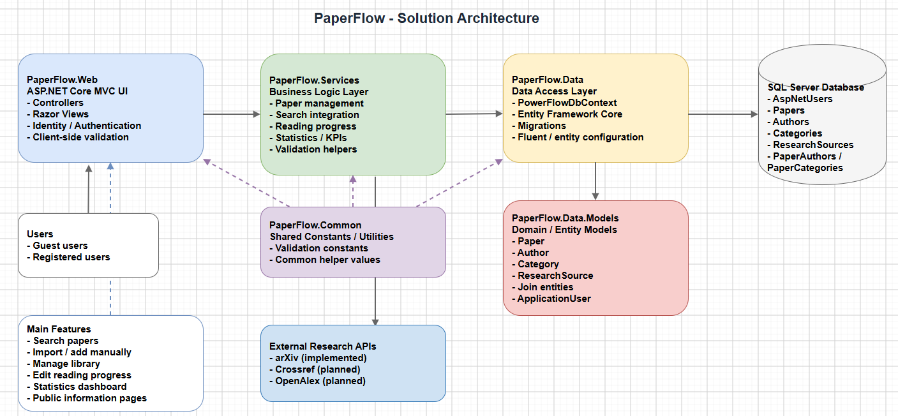
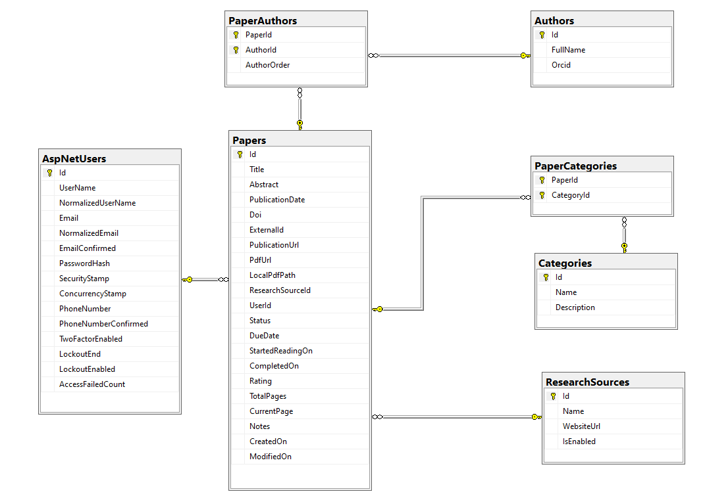

# PaperFlow

> A research paper management web application for discovering publications, organizing a personal library, and tracking reading progress.


## Table of Contents

- [About the Project](#about-the-project)
- [Technologies Used](#technologies-used)
- [Prerequisites](#prerequisites)
- [Clean Installation Verification](#clean-installation-verification)
- [Project Structure](#project-structure)
- [Architecture Overview](#architecture-overview)
- [Features](#features)
- [Usage](#usage)
- [Database Setup](#database-setup)
- [Configuration](#configuration)
- [License](#license)
- [Contact](#contact)

## About the Project

PaperFlow helps students and researchers keep track of scientific publications without maintaining a separate collection of bookmarks, PDFs, and reading notes. Users can search arXiv, import publications, manually create paper records, and manage a private research library. Reading status, page progress, deadlines, notes, ratings, and statistics make it easier to follow ongoing research work.

PaperFlow uses ASP.NET Core MVC, Entity Framework Core with SQL Server, and ASP.NET Core Identity. It includes a public landing page and information pages, while personal research functions require an account.

## Technologies Used

| Technology | Version / Details | Purpose |
|---|---|---|
| C# / .NET | .NET 10 (`net10.0`) | Application runtime and language |
| ASP.NET Core MVC | .NET 10 | Controllers and Razor Views |
| ASP.NET Core Identity | .NET 10 | Registration, authentication and account management |
| Entity Framework Core | 10.x | SQL Server ORM, relationships, and migrations |
| Microsoft SQL Server / SQL Server LocalDB | Local installation | Persistent relational database |
| Bootstrap | Bootstrap 5 | Responsive page layout and forms |
| Razor Views and Razor Pages | ASP.NET Core | MVC UI and Identity account pages |
| JavaScript / jQuery Validation | Bundled frontend assets | Interactive search and form validation |
| Chart.js | Statistics dashboard | Library and reading activity charts |
| Modernize | Customized Bootstrap-based theme | Application layout, sidebar and dark mode |
| arXiv API | External service | Publication search and import |

> Exact third-party frontend package versions and their license notices should be checked against the committed `wwwroot` assets before release.

## Prerequisites

- [.NET 10 SDK](https://dotnet.microsoft.com/download)
- [Visual Studio 2022](https://visualstudio.microsoft.com/) with ASP.NET and web development workload, or VS Code with the C# extension
- SQL Server Express (`.\SQLEXPRESS`, tested), Developer Edition, or SQL Server LocalDB (Windows alternative)
- [Git](https://git-scm.com/)
- An internet connection for restoring NuGet packages and searching arXiv
- `dotnet-ef` CLI tool if applying migrations using the command line

## Getting Started

### 1. Clone the repository

```powershell
git clone https://github.com/ninovvas/paperFlow-asp-net-core-app.git
cd paperFlow-asp-net-core-app
```

### 2. Restore dependencies

Run from the repository root:

```powershell
dotnet restore PaperFlow.Web/PaperFlow.Web.csproj
```

### 3. Configure SQL Server

PaperFlow reads **`ConnectionStrings:DefaultConnection`**. The clean installation was successfully tested with SQL Server Express and a database named `PaperFlowDb`:

```json
{
  "ConnectionStrings": {
    "DefaultConnection": "Server=.\\SQLEXPRESS;Database=PaperFlowDb;Trusted_Connection=True;MultipleActiveResultSets=true;TrustServerCertificate=True;Encrypt=False;"
  }
}
```

Use the connection string in `PaperFlow.Web/appsettings.Development.json`, or supply it through the environment variable `ConnectionStrings__DefaultConnection` (see [Configuration](#configuration)). Do not commit personal credentials. Start the local `SQL Server (SQLEXPRESS)` service before applying migrations.

**LocalDB alternative (not used for the documented successful test):**

```json
{
  "ConnectionStrings": {
    "DefaultConnection": "Server=(localdb)\\MSSQLLocalDB;Database=PaperFlowDb;Trusted_Connection=True;TrustServerCertificate=True"
  }
}
```

The same configuration can be supplied through an environment variable named `ConnectionStrings__DefaultConnection`. Do not commit credentials or machine-specific private configuration.

> The database name `PaperFlowDb` is just the database name; the `--context` command argument must use the C# context class `PowerFlowDbContext`. The default connection string must point to an available SQL Server instance.

### 4. Apply the existing migrations

If the EF Core CLI tool is not installed:

```powershell
dotnet tool install --global dotnet-ef --version "10.*"
```

Verify the tool and optionally list the existing migrations:

```powershell
dotnet ef --version
dotnet ef migrations list --project PaperFlow.Data/PaperFlow.Data.csproj --startup-project PaperFlow.Web/PaperFlow.Web.csproj --context PowerFlowDbContext
```

Then run from the repository root:

```powershell
dotnet ef database update --project PaperFlow.Data/PaperFlow.Data.csproj --startup-project PaperFlow.Web/PaperFlow.Web.csproj --context PowerFlowDbContext
```

The repository already includes migrations for ASP.NET Core Identity and the PaperFlow domain models. **Do not generate a new `InitialCreate` migration for a fresh installation.**

### 5. Run the application

```powershell
dotnet run --project PaperFlow.Web/PaperFlow.Web.csproj --launch-profile https
```

The configured development URLs are:

- **HTTPS:** `https://localhost:7184`
- **HTTP:** `http://localhost:5205`

If the local HTTPS development certificate is not trusted, use:

```powershell
dotnet dev-certs https --trust
```

On first launch, open the public landing page and register an account to access personal research features.

## Clean Installation

A clean installation was **successfully performed on Windows 11 (26 October 2026)** using the public GitHub repository, .NET 10 and **SQL Server Express (`.\SQLEXPRESS`)**. 

The clean installation proves that the application can be cloned, compiled, migrated, and launched **in the tested Windows environment without changes to C# source code**. Full cross-machine portability and a complete end-to-end feature test have not been established.

### 1. Clone and build

Open **Windows Command Prompt (CMD)** in an empty directory:

```cmd
git clone https://github.com/ninovvas/paperFlow-asp-net-core-app.git
cd paperFlow-asp-net-core-app
dotnet restore PaperFlow.Web/PaperFlow.Web.csproj
dotnet build PaperFlow.Web/PaperFlow.Web.csproj
```

### 2. Configure the tested SQL Server Express connection

Start the `SQL Server (SQLEXPRESS)` Windows service. The following connection string was used during the successful test:

```json
{
  "ConnectionStrings": {
    "DefaultConnection": "Server=.\\SQLEXPRESS;Database=PaperFlowDb;Trusted_Connection=True;MultipleActiveResultSets=true;TrustServerCertificate=True;Encrypt=False;"
  }
}
```

Provide it through `PaperFlow.Web/appsettings.Development.json` or an environment variable. If using **CMD** for the current session:

```cmd
set ASPNETCORE_ENVIRONMENT=Development
set "ConnectionStrings__DefaultConnection=Server=.\SQLEXPRESS;Database=PaperFlowDb;Trusted_Connection=True;MultipleActiveResultSets=true;TrustServerCertificate=True;Encrypt=False;"
```

For **PowerShell**, use:

```powershell
$env:ASPNETCORE_ENVIRONMENT = "Development"
$env:ConnectionStrings__DefaultConnection = "Server=.\SQLEXPRESS;Database=PaperFlowDb;Trusted_Connection=True;MultipleActiveResultSets=true;TrustServerCertificate=True;Encrypt=False;"
```

Use the same terminal session for migration and startup when using session-scoped environment variables. `SQLEXPRESS` is an example of an installed SQL Server instance; adjust the configuration if your system uses a different instance. Do not change application source code or commit passwords.

### 3. Install EF Core CLI (once per computer)

On the clean-install machine, `dotnet ef` was initially unavailable. Install the CLI tool and verify it:

```cmd
dotnet tool install --global dotnet-ef --version "10.*"
dotnet ef --version
```

If the tool was previously installed, use `dotnet tool update --global dotnet-ef --version "10.*"` as needed. On Windows, reopen the terminal if the global-tools PATH has not refreshed (`%USERPROFILE%\.dotnet\tools`).

### 4. Apply and verify existing migrations

From the repository root:

```cmd
dotnet ef migrations list --project PaperFlow.Data/PaperFlow.Data.csproj --startup-project PaperFlow.Web/PaperFlow.Web.csproj --context PowerFlowDbContext

dotnet ef database update --project PaperFlow.Data/PaperFlow.Data.csproj --startup-project PaperFlow.Web/PaperFlow.Web.csproj --context PowerFlowDbContext

dotnet ef migrations list --project PaperFlow.Data/PaperFlow.Data.csproj --startup-project PaperFlow.Web/PaperFlow.Web.csproj --context PowerFlowDbContext
```

The successful test returned the following migrations without a `(Pending)` suffix:

```text
00000000000000_CreateIdentitySchema
20261014040542_AddPaperFlowModels
```

**Do not create a new `InitialCreate` migration.** Existing migrations build the database schema. `PowerFlowDbContext` is the .NET DbContext class; `PaperFlowDb` is the SQL Server database name.

### 5. Run the application

```cmd
dotnet run --project PaperFlow.Web/PaperFlow.Web.csproj --launch-profile https
```

Visit **https://localhost:7184**. If the local HTTPS certificate is not trusted, run `dotnet dev-certs https --trust`.

### 6. Functional smoke test

After startup, check the public Landing, About and Research Sources pages. Register a test user and verify login, manual paper creation, edit/delete, reading progress and statistics. Verify that private pages redirect an unauthenticated visitor to login. These checks are recommended for each fresh installation.

arXiv is an external provider. Its API returned HTTP 503 and `Rate exceeded` during testing; PaperFlow handled the failure with an explanatory notice. An arXiv search and bulk import later succeeded. Availability may vary; manual paper entry and the local research library do not require arXiv to be online.

### 7. Troubleshooting

| Problem | Resolution |
|---|---|
| `dotnet ef` is not recognized | Install `dotnet-ef` as shown above; reopen CMD if necessary. |
| Migrations command uses `--context PowerFlowDbTest` | Use `--context PowerFlowDbContext` (the class name), not the database name. |
| SQL Server is unreachable | Start `SQL Server (SQLEXPRESS)`; check `DefaultConnection` and Windows authentication. |
| Migration is marked `(Pending)` | Run `dotnet ef database update` with the correct project and context. |
| HTTPS certificate warning | Run `dotnet dev-certs https --trust`. |
| Port 7184 already in use | Stop any other PaperFlow instance, then restart. |
| arXiv responds with 429, 503 or `Rate exceeded` | External provider limitation. Retry later; local Paper CRUD remains available. |

## Project Structure

```text
PaperFlow.Common/                 Shared constants and enums
PaperFlow.Data.Models/            Paper, Author, Category, ResearchSource and link entities
PaperFlow.Data/                   EF Core DbContext, SQL Server registration and migrations
PaperFlow.Services/               Research search, import, CRUD and statistics services
  Interfaces/                     Service contracts
  Models/                         Service-level data transfer models
  Providers/                      arXiv provider and request coordination
PaperFlow.Web/                    ASP.NET Core MVC presentation project
  Controllers/                    MVC actions and library search endpoints
  ViewModels/                     Form and view-specific models
  Views/                          Razor MVC views and partials
  Areas/Identity/                 ASP.NET Core Identity pages
  wwwroot/                        CSS, JavaScript, themes and static resources
  appsettings.json                Application configuration
  Program.cs                      Dependency injection, middleware and routes
  PaperFlow.Web.slnx              Visual Studio solution
```

## Architecture Overview

PaperFlow follows a layered **ASP.NET Core MVC** architecture with a clear separation between presentation, business logic, data access, and domain models. This structure keeps the project easier to maintain, extend, and explain during evaluation.

### Solution layers

- **PaperFlow.Web**: presentation layer with MVC controllers, Razor views, Identity pages, navigation, and client-side interaction.
- **PaperFlow.Services**: business logic for paper management, search integration, reading progress, validation, and statistics.
- **PaperFlow.Data**: data access layer with Entity Framework Core, `PowerFlowDbContext`, and migrations.
- **PaperFlow.Data.Models**: domain and database entities such as `Paper`, `Author`, `Category`, `ResearchSource`, and join entities.
- **PaperFlow.Common**: shared constants and reusable helper values used across the solution.

### Architecture diagram

The project architecture is showed in the diagram below:




### Request and data flow

1. The user interacts with **PaperFlow.Web** through MVC pages and forms.
2. Controllers call **PaperFlow.Services** to execute application logic.
3. Services use **PaperFlow.Data** to read and write data with Entity Framework Core.
4. **PaperFlow.Data.Models** define the entities stored in SQL Server.
5. For external search, the services layer communicates with **arXiv**. Planned future integrations include **Crossref** and **OpenAlex**.

### Database schema

PaperFlow uses SQL Server together with Entity Framework Core Code-First. The main domain tables are:

- `Papers`
- `Authors`
- `Categories`
- `ResearchSources`
- `PaperAuthors`
- `PaperCategories`
- `AspNetUsers`

## Database Schema




### Supported and planned sources

- **arXiv**: currently integrated and used for paper search/import.
- **Crossref**: planned for future DOI and metadata integration.
- **OpenAlex**: planned for future works, authors, and citation metadata support.

## Features

### Available

- Account registration, login, logout, profile management and password change using ASP.NET Core Identity.
- Public landing page, About PaperFlow and Research Sources information pages.
- arXiv publication search and import, including controls for external API rate limits.
- Manual paper creation and complete paper CRUD (create, view, edit, delete).
- Personal library with search by title, DOI, authors, category and abstract; filtering, sorting and pagination.
- Header search with suggestions for saved papers.
- Author and category associations, DOI normalization and duplicate protection.
- Reading status, reading deadline, completed progress, current/total pages, ratings and personal notes.
- Research statistics such as monthly additions, completed papers, categories and sources.
- Server-side form validation and client-side validation, with responsive dark/light themes.
- Protected personal data using authorization and user-scoped database queries.

### Planned but not implemented

- Crossref integration for DOI and publication metadata.
- OpenAlex integration for works, author and citation metadata.

> The availability of external arXiv requests depends on its service limits and network connectivity.

## Usage

1. Visit `/` to read about PaperFlow, available features and planned research sources.
2. Register a user account and log in.
3. Use **Search Papers** to find publications on arXiv and import selected results.
4. Use **Add Paper Manually** to create a record without an external provider.
5. Open **My Papers** to filter, search, open, edit or delete papers.
6. Open an individual paper to update **Reading Information**, including progress, rating and notes.
7. Open **Statistics** to review personal research activity and library distributions.
8. Use the header search to locate papers already stored in your own library.


## Database Setup

PaperFlow follows the Entity Framework Core Code-First approach and uses `PowerFlowDbContext` in `PaperFlow.Data`.

Main entities:

- `Paper`: publication metadata, user ownership, reading progress and notes.
- `Author` and `PaperAuthor`: authors and many-to-many relationships.
- `Category` and `PaperCategory`: research categories and many-to-many relationships.
- `ResearchSource`: origin of imported papers.
- ASP.NET Core Identity tables: accounts and authentication.

The `DefaultConnection` configuration key is required. Apply the **existing** migrations with:

```powershell
dotnet ef database update --project PaperFlow.Data/PaperFlow.Data.csproj --startup-project PaperFlow.Web/PaperFlow.Web.csproj --context PowerFlowDbContext
```

## Configuration

| Setting | Required | Description |
|---|---|---|
| `ConnectionStrings:DefaultConnection` | Yes | SQL Server or LocalDB connection string used by `PowerFlowDbContext` |
| `ASPNETCORE_ENVIRONMENT` | For development profile | `Development` for local developer settings |
| `ASPNETCORE_URLS` | Optional | Overrides listening URLs if not using a launch profile |
| `ConnectionStrings__DefaultConnection` | Optional alternative | Environment-variable representation of `DefaultConnection` |

Example using PowerShell environment variables for the current session:

```powershell
$env:ASPNETCORE_ENVIRONMENT = "Development"
$env:ConnectionStrings__DefaultConnection = "Server=(localdb)\MSSQLLocalDB;Database=PaperFlowDb;Trusted_Connection=True;TrustServerCertificate=True"
```

No arXiv API key is required for the current arXiv integration. Avoid committing SQL credentials, tokens, passwords, User Secrets contents or personal data. Environment variables and ASP.NET Core User Secrets can be used for private development settings.

## License

PaperFlow is licensed under the **MIT License**. See the [LICENSE](LICENSE) file for the full terms. Copyright (c) 2026 Vasil Ninov.

Third-party components and frontend assets retain their own licenses.

## Contact

- **Author:** Vasil Ninov
- **Project repository:** [PaperFlow on GitHub](https://github.com/ninovvas/paperFlow-asp-net-core-app)


